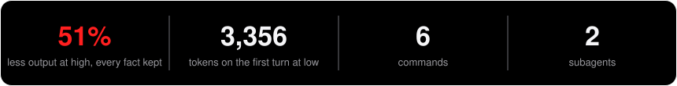
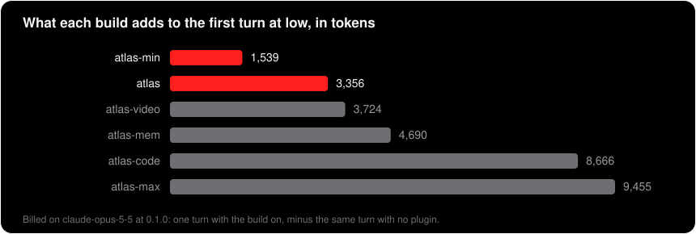
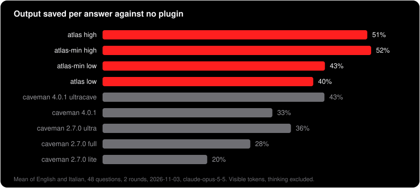
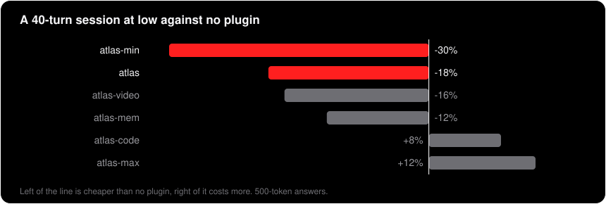
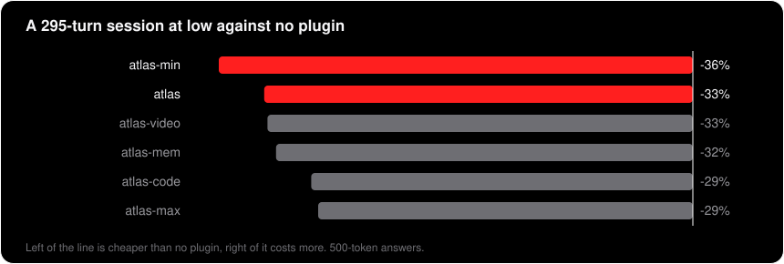

<p align="center"></p>
<p align="center"></p>

**Most of what an assistant writes is packaging: greetings, restatements, hedges, a summary of what it just said. ATLAS removes the packaging and keeps every fact, and it does so on turn fifty as reliably as on turn one.** A Claude Code plugin, off until you switch it on.

```
/plugin marketplace add Z0CC0/ATLAS
/plugin install atlas@atlas
```

Then, in any chat: `atlas low` or `atlas high`.

**One answer from the bench, as it came out.** The question was "Is it worth putting an index on a column that has only three distinct values?", with the same sheet of facts for both.

`atlas high`, 80 tokens:

> Usually not. Planner ignores B-tree index on low-cardinality column, preferring sequential scan when filter selects more than roughly 5-10% of rows. Index still costs writes and disk space. Exception: partial index on the rare value works.

<details>
<summary>No plugin, 377 tokens</summary>

> Usually not. A regular B-tree index on a column with only three distinct values is normally ignored by the query planner. Each value matches a large share of the table, and once a filter selects more than roughly 5–10% of the rows, the planner decides a sequential scan is cheaper than jumping back and forth through the index. So the index rarely speeds up your reads.
>
> It still costs you, though. Every INSERT, UPDATE and DELETE has to maintain it, and it takes up disk space. You pay for it on every write and get little or nothing back on reads.
>
> **The exception:** if one of the three values is rare and you query for it often, a partial index on just that value works well. For example, with a `status` column where most rows are `'done'` and only a few are `'pending'`:
>
> ```sql
> CREATE INDEX orders_pending_idx ON orders (id) WHERE status = 'pending';
> ```
>
> The index covers only the rare rows, so it stays small and cheap to maintain. Queries like `WHERE status = 'pending'` select a small fraction of the table, so the planner will actually use it.
>
> So skip the plain index. Add a partial index only if you regularly filter on a value that's uncommon.

</details>

It drops the example of the partial index, and keeps every fact on the sheet. The files are `atlas-test/generated/opus.en/C_breve.atlas-high.1.txt` and `C_breve.none.1.txt`.

## The family

Install one: two ATLAS builds side by side inject the rules and the reminder twice.

| build | what it is | commands | subagents | installed, switched off | first turn at `low` | first turn at `high` | 40 turns at `low` | 295 turns at `low` |
|---|---|---|---|---|---|---|---|---|
| [`atlas`](https://github.com/Z0CC0/ATLAS) | the rules, the dials, search and the browser | 6 | 2 | 1,238 | 3,356 | 3,536 | -18% | -33% |
| [`atlas-min`](https://github.com/Z0CC0/ATLAS/tree/main/atlas-min) | compression only | 1 | 0 | about 0 | 1,539 | 1,721 | -30% | -36% |
| [`atlas-video`](https://github.com/Z0CC0/ATLAS-video) | `atlas` plus video made on your machine | 8 | 2 | 1,601 | 3,724 | 3,905 | -16% | -33% |
| [`atlas-mem`](https://github.com/Z0CC0/ATLAS-mem) | `atlas` plus review, fix, a memory and a program reader | 11 | 5 | 2,569 | 4,690 | 4,873 | -12% | -32% |
| [`atlas-code`](https://github.com/Z0CC0/ATLAS-code) | `atlas` plus coding and documents | 28 | 10 | 6,167 | 8,666 | 8,886 | +8% | -29% |
| [`atlas-max`](https://github.com/Z0CC0/ATLAS-max) | all of it | 32 | 10 | 6,955 | 9,455 | 9,672 | +12% | -29% |

Tokens are billed on `claude-opus-5-5` at 0.1.0: one turn with the build on, minus the same turn with no plugin. The no-plugin turn itself moved by about 140 tokens between runs, so a smaller difference is noise. The last two columns are a session against no plugin, and negative is cheaper. Only `atlas` and `atlas-min` had their output measured; the others are assumed to save what `atlas` saves.

Each repository explains its part in full, with what it costs and where others do it better: [ATLAS-code](https://github.com/Z0CC0/ATLAS-code), [ATLAS-mem](https://github.com/Z0CC0/ATLAS-mem), [ATLAS-video](https://github.com/Z0CC0/ATLAS-video), [ATLAS-max](https://github.com/Z0CC0/ATLAS-max).

<p align="center"></p>

## What it does

**Compression** — `atlas low` drops filler, pleasantries, hedging, articles and the copula. `atlas high` halves the words: every fact stays, every explanation goes. Code, error strings, paths, numbers, negations and proper names are never touched at either level. Anything written for other people — commits, docs, pull requests, memory files — is written in ordinary prose whatever the dial says.

**Rigour** — `atlas ask` makes it clarify the goal before building: one question at a time, multiple choice where the options can be named, on every request and not only the first. Bounded tasks — a typo, a rename — are just done.

**Check** — `atlas check` works against invented facts: nothing from memory, primary sources first, its own work verified before it is called done, a second option looked for before recommending the first, a correction verified before it is accepted. "I did not find it" is never written as "it does not exist".

**Silent** — `atlas silent` hands over the result and stops: no narration between tool calls, no closing summary, no offer of what to do next. Three things are still said, one line each: an irreversible action before it happens, a task that cannot run as written, a result that is wrong.

All four persist across turns, restarts and projects until changed, and move independently: `atlas ask off` leaves the other three where they were.

**Two subagents** keep the expensive reading out of your conversation: `atlas-research` (an answer with sources, or a reading list; with "is there a free API for this", the public catalogues; with "what do people say", open forums and what search engines show of social networks) and `atlas-browser` (does the page work, without a screenshot in your context).

## Commands

| command | what it does |
|---|---|
| `/atlas:atlas` | set the dials |
| `/atlas:atlas-help` | the reference card |
| `/atlas:atlas-recap` | write a handover file for the conversation |
| `/atlas:atlas-search` | answer only from a web search; with "give me sources", where to read instead |
| `/atlas:atlas-organize` | tidy a local folder, with an undo |
| `/atlas:atlas-silent` | do it and hand over the result, nothing else |

## It ships off

A fresh install changes nothing. The first session prints one line saying it is there and how to
switch it on; after that it does nothing until you do.

```
atlas low      shorter answers
atlas high     half the words
atlas status   what is on
atlas off      back to nothing
```

**The setting is per project and it persists** — across turns and restarts, until you change it.
It is not a per-conversation mode: switch it on once in a repository and every new chat opened
there starts that way. Another repository is another setting, off until you say otherwise, so
`atlas high` set for one piece of work never follows you into the next. `atlas off` persists the
same way. A project is the folder the session runs in, walked up to the nearest `.git` or
`.atlas.json`, so a chat opened in a subfolder shares the repository's dials.

**Uninstalling does not reset it.** The dial states live in `~/.claude/atlas-state/`, one small
file per project, outside the plugin, so removing and reinstalling brings back whatever was set
before. Type `atlas off` in a project before uninstalling, or delete that folder — nothing else
depends on it. Nothing is ever written inside your repositories.

## Measured

Every number below is measured and can be rerun: the questions, all the answers, every verdict and the scripts are in [`atlas-test/`](atlas-test/README.md). The unfavourable ones are printed with the rest.

<p align="center"></p>

**How.** 24 English and 24 Italian questions, each with its own sheet of notes, so every setup answers with the same information and only the form can change. Each was answered twice per setup, on `claude-opus-5-5` on 2026-11-03, in an empty folder with only the plugin under test loaded. Tokens are the API's own count of the visible answer, thinking excluded.

| setup | output, English | output, Italian | notes lost, English | notes lost, Italian |
|---|---|---|---|---|
| `atlas low` | -42% | -39% | 0 of 176 | 0 of 176 |
| `atlas high` | -52% | -50% | 0 of 176 | 0 of 176 |
| `low` + `ask` | -43% | -40% | 0 of 176 | 0 of 176 |
| `low` + `check` | -41% | -39% | 0.5 of 176 | 0 of 176 |
| `low` + `ask` + `check` | -42% | -41% | 0 of 176 | 0 of 176 |
| `high` + `ask` | -53% | -50% | 0 of 176 | 0.5 of 176 |
| `high` + `check` | -50% | -48% | 0 of 176 | 0 of 176 |
| `high` + `ask` + `check` | -51% | -48% | 0 of 176 | 0 of 176 |
| `atlas-min` at `low` | -44% | -42% | 0 of 176 | 0 of 176 |
| `atlas-min` at `high` | -53% | -50% | 0 of 176 | 0 of 176 |
| caveman 4.0.1 | -33% | -32% | 0 of 176 | 0 of 176 |
| caveman 4.0.1 `ultracave` | -45% | -41% | 0 of 176 | 0 of 176 |
| caveman 2.7.0 `lite` | -20% | -20% | 0 of 176 | 0 of 176 |
| caveman 2.7.0 `full` | -28% | -29% | 0 of 176 | 1 of 176 |
| caveman 2.7.0 `ultra` | -37% | -35% | 0 of 176 | 0 of 176 |
| i-have-adhd | -6% | -7% | 0 of 176 | 0 of 176 |

**Notes lost** is how many of a sheet's notes a reader can no longer learn from the answer, the median across rounds, minus what the no-plugin answer already lost. `claude-sonnet-5-5` read every answer against its whole sheet with no plugin and no configuration name in sight, and read again with the question beside the answer whatever it had marked absent, because `14:20.` does answer "what time is it in London?". Controls inside every call: a note from another question was called present 0 times in 1,728 calls, and a sentence copied from the answer was called absent 3 times in 1,666. Then real answers with the sentences carrying one note deleted: the judge still called that note present 13 times of 120, some because the information was stated elsewhere too, and called a note left in absent 0 times of 113. So a real loss can slip past it, and a zero means "very few", not "none".

**The bill counts thinking too.** Summed over the same 48 answers per setup, billed output against no plugin: `atlas low` -29% in English and -25% in Italian, `atlas high` -38% in English and -35% in Italian, `low` + `check` -12% in English and -4% in Italian, `atlas-min` at `high` -42% in English and -39% in Italian, caveman 4.0.1 `ultracave` -42% in English and -38% in Italian. `check` costs more by design, because it looks things up.

**Why these figures are higher than the ones ATLAS published before.** That run loaded the settings of the machine it ran on, including an output style that already asked for short answers, so the no-plugin answers were 11% shorter than here. This run leaves every setting out, so it measures each plugin against plain Claude Code. The difference between setups is what to compare, not the level.

**Over a session,** against no plugin, in visible tokens: the first turn, then per turn the reminder plus an answer shortened by that setup's own saving, with a 500-token answer. Negative is cheaper. Read these as reading cost, not as the bill.

<p align="center"></p>
<p align="center"></p>

| `atlas` setup | 40 turns | 295 turns |
|---|---|---|
| `low` | -18% | -33% |
| `high` | -27% | -42% |
| `low` + `ask` | -15% | -31% |
| `low` + `check` | -10% | -29% |
| `low` + `ask` + `check` | -7% | -29% |
| `high` + `ask` | -23% | -40% |
| `high` + `check` | -16% | -38% |
| `high` + `ask` + `check` | -13% | -35% |

**Fixed cost,** counted with tiktoken `o200k_base`, an approximation of Claude's tokenizer: 1,408 tokens of rules at `low` and 824 of names and descriptions. The API bills more: 1,238 when installed and off, 3,356 on the first turn at `low`. The bill depends on the model, and a cheaper model can bill less for the same build. On a long session the per-turn reminder of 27-32 tokens outweighs all of it: over 295 turns, 7,965 tokens.

## How it compares

ATLAS is compared here with [caveman](https://github.com/JuliusBrussee/caveman) (116,900 stars on 2026-11-02, Apache-2.0), the project it is most often put beside and the one its compression was first measured against. Both are in the table above, measured in the same run: the current caveman 4.0.1 and the 2.7.0 that was installed when ATLAS was built.

| | `atlas high` | caveman 4.0.1 `ultracave` | caveman 4.0.1 |
|---|---|---|---|
| output saved per answer, English | 52% | 45% | 33% |
| output saved per answer, Italian | 50% | 41% | 32% |
| notes lost | 0 of 176 | 0 of 176 | 0 of 176 |
| added to the first turn in the bench, tools off | 3,045 | 2,547 | 3,342 |

In caveman 4.0.1, `lite` and `full` are the same level, `caveman`, so they appear once.

**Where ATLAS is better:** it shortens more, about 7 points more than `ultracave` in English and 9 in Italian, and loses no more. It adds the dials caveman does not have: questions before building, checks before claims, silence on request. Its hooks and its CLI send nothing anywhere.

**Where caveman is better:** `ultracave` costs about 500 tokens less on the first turn. It does far more than the voice: a proxy that shrinks what tools return before the model reads it, which ATLAS does not do at all, since it shortens output only; compressed web pages; a tool that rewrites memory files; model routing; and 30+ other agents. Its CLI sends usage statistics by default, with `caveman telemetry off` to stop it; the plugin hooks measured here make no network call, as far as their code shows.

**Not measured:** the proxy, which cuts input rather than output, so these tables cannot see it.

## Getting the most out of it

Everything below follows from the measurements above. None of it is required; each line says what it buys.

**Pick the level by the reader, not by the task.** `high` when you read the answer once and act on it. `low` when you re-read, paste it somewhere, or someone else reads it: the token gap between the two is a few points, the readability gap is not.

**Long sessions are where it pays.** The fixed cost is paid once per chat. Ten chats of five turns pay it ten times; one chat of fifty turns pays it once. Keep working in the same chat and use `atlas-recap` when it has to end, so the next one starts with the state instead of the story.

**Turn on `ask` for open-ended work, off for bounded work.** It earns its cost when the goal can move: a new feature, a refactor, a design. On a typo or a rename it is a question you did not need.

**Turn on `check` for facts, off for code you can run.** Versions, prices, APIs, how someone else's software behaves: on. A function you will test in the next minute: off, the test is the check.

**`silent` for batches.** A list of mechanical changes, a migration, anything where you will read the diff and not the prose.

**Delegate what is bigger than its answer.** A test log, a screenshot, a catalogue, a hundred-file search: send it to the subagent and pay for the verdict. Read directly what you will need to see anyway.

**Write the request with the constraint in it.** "In under 50 lines", "only the failing test", "one option, not a comparison": the model follows a stated bound better than any rule about brevity, and the bound costs you a few words.

**Every plugin you install costs its descriptions in every chat, on or off.** This one bills 1,238 tokens, and a large toolkit can be 30,000. Remove what you have not used in a month.

**`atlas-min` when tokens are the only thing you want.** Same compression rules, one command, no subagents, 34 tokens of descriptions, and it saves 52% per answer at `high`.

**Memory files in English.** They load at every start; the tokenizer reads English about a third cheaper than Italian and cheaper still than most other languages. Write `MEMORY.md` in English even if you talk to the model in your own.

**Put project names in `atlas-terms.txt`.** One per line: never compressed, never translated, never abbreviated.

**Pin a project's dials in `.atlas.json`** when the same repository always wants the same setup, and leave the per-project state for everything else.

**Connect Context7 if you ask about libraries.** One call for the right version's docs, where a search takes four; `check` and `atlas-research` use it first when it is there.

## Advantages

- **It holds.** The rules are injected at session start and re-stated in a short line on every turn, so the style does not drift back after twenty messages. That line names the rules that slip first, not only the state.
- **Next to nothing is lost.** Measured at `high`: 0 of 176 notes. Compression removes packaging, not facts. Negations, qualifiers that change what is true, numbers, names, paths and error strings survive at every level; a shorter answer missing one of them has failed.
- **Every rule is binary.** A rule that needs a judgment call every time it applies loses to habit by turn fifty. What ships is only the kind a model can follow as a yes or no: one word when one word answers, first line answers the question, no list markers, at most two bold spans, no tables unless asked.
- **Four dials, no combined modes.** `high` + `ask` + `check` is three two-word commands, and each can be turned off alone.
- **The subagents pay for themselves immediately.** One screenshot is about 9,800 tokens, a catalogue is 550,000 tokens. None of it enters your conversation.
- **Everything is local.** No account, no gateway, no telemetry. The hooks touch only the files listed under "What leaves your machine", all on this computer. Two subagents reach the network because fetching is their job, and only when you delegate to them.
- **It ships off, and switching it off sticks.** No behaviour changes until you ask, and `atlas off` survives a restart.

## Disadvantages

- **It cannot search everywhere.** Asked what people say, `atlas-search` reads Hacker News, Lemmy, Stack Overflow and GitHub, which answer with no account. Reddit, X, Bluesky, LinkedIn, Instagram, TikTok, Facebook, Threads and Mastodon show a stranger little or nothing, so it sees only what search engines show of them, and it says so in every answer. No login, no cookie, and no way round a refusal.
- **It is a style constraint on a language model, not a filter.** The model follows it most of the time, not all of the time. On long sessions it occasionally slips — an article here, a list marker there — and the per-turn reminder exists because of that, not instead of it.
- **`low` and `high` are close.** Measured: `low` 42% and `high` 52% less output in English, 39% and 50% in Italian. `high` is the harder rule set and reads more telegraphically: the saving is real, and so is the cost in readability.
- **Short sessions pay less.** The fixed cost is paid before the first answer: `atlas` at `low` is -18% over 40 turns and -33% over 295. A session of a handful of turns with short answers may not pay at all.
- **The per-turn reminder scales with turns.** Over 295 turns it costs more than the whole first turn. It is as short as it can be while still naming rules.
- **`check` adds tokens by design.** Verifying means looking things up. It is the one dial that costs more than it saves in tokens; it is paid for by the compression running underneath it.
- **`ask` cannot know what you have not said.** It reduces wrong assumptions; it does not remove them.
- **English commands, English hook phrases.** Requests in any language are recognised by the model, but the phrases the hook matches by itself ("stop atlas", "normal mode") are English. `atlas off` is a name and works everywhere.
- **The state is per project, keyed by the folder a session runs in** (walked up to the nearest `.git` or `.atlas.json`). Two checkouts of the same repository are two settings; a folder with no `.git` is its own project. Stored outside the plugin, so uninstalling does not reset it.
- **`atlas-browser` needs the desktop app's Browser pane.** From the plain CLI it has nothing to drive and says so.

- **The compression figure is 2 rounds on 48 questions with fixed fact sheets, on one model (`claude-opus-5-5`, 2026-11-03).** It measures form with the information held constant; answers that have to find their own facts vary more, and another model compresses by another amount.
- **It shortens output only.** Your input, your files and what tools return are not touched: a hook cannot rewrite a tool's result.

## Recommended companions

ATLAS works on its own. It works better with these three connected — none is required, and no
rule ever says an answer is unavailable because one is missing.

| server | what ATLAS does with it | install |
|---|---|---|
| **Context7** | `atlas-research` and `check` ask it first for library APIs: one call for the right version, where a search takes four and may land on a page about another one | `claude mcp add --transport http --scope user context7 https://mcp.context7.com/mcp` |
| **Chrome DevTools MCP** | the two things `atlas-browser` cannot do — pages behind a login, and performance traces. It hands those back rather than reporting what an anonymous visitor sees | `claude mcp add --scope user chrome-devtools -- npx -y chrome-devtools-mcp@latest` |
| **Composio** | one gateway to Gmail, Notion, Slack, GitHub and the rest, so the subagents reach real data instead of only the web | `claude mcp add --transport http --scope user composio https://connect.composio.dev/mcp` then `claude mcp login composio` |

`--scope user` matters: without it the server exists only in the project you ran the command in.
Restart Claude Code afterwards — MCP servers are read at startup.

**Order, for the browser**: `atlas-browser` first, the external one only for what it hands back.
The subagent keeps screenshots out of your conversation; driving Chrome yourself does not.

**Composio holds OAuth tokens for the accounts you connect.** Connect only what you use.

## What leaves your machine

**Nothing you did not ask for.** The rules, the dials and the hooks are entirely local: they read
only the files in the table below and write only the state file, plus `~/.claude/atlas.json` when
you type a guard switch; `atlas-code` adds one small file per session in the system temp folder
while `gate` is on, `atlas-mem` the harvest file of the vault before a compaction. Nothing about
your sessions is ever sent anywhere.

Two subagents do reach the network, because fetching is their job, and only when you delegate to
them: `atlas-research` searches and opens pages and fetches the public catalogues,
`atlas-browser` drives a page you named. They send your query, nothing else. `atlas-min`
ships neither and makes no network calls at all.

| file | purpose |
|---|---|
| `~/.claude/atlas-state/<project>.state` | the four dials of one project, e.g. `high:ask:on:off` |
| `~/.claude/atlas-terms.txt` | your untouchable terms, one per line. Ships empty |
| `<project>/.atlas.json` | optional per-project default |
| `~/.claude/atlas.json` | optional default for every project, the guard switches of `atlas-code`, the vaults `atlas-mem` may use |
| `<temp>/atlas-gate-<session>.json` | `atlas-code` only, `gate` on: the files the gate already turned back in this session |
| `<vault>/.atlas/harvest/<session>.md` | `atlas-mem` only: written before a compaction, the lines of that session that read like a decision |

`~/.claude` is `$CLAUDE_CONFIG_DIR` when that is set, for every file above.

On a question about what people say, `atlas-search` runs `tools/social.mjs`, which sends your search words to `hn.algolia.com`, `lemmy.world`, `api.stackexchange.com` and `api.github.com`, and nothing else.

## Untouchable terms

One term per line in `~/.claude/atlas-terms.txt`. Never compressed, never translated, never
abbreviated. Ships empty on purpose — a published plugin should not carry anyone's project names.

```
# lines starting with # are ignored
PelicanDB
retry_budget
```

## Turning it off

`atlas off`, or "stop atlas". The state file is written as off and stays that way across
restarts, for the project you typed it in. Removing the plugin does not touch it: delete the
`~/.claude/atlas-state/` folder by hand if you want no trace left.

## The app

ATLAS is also a desktop app for Windows, **not yet available**: there is nothing to download. It keeps several AI services in one window, each in its own panel, with separate cookies for each account, beside Claude Code and Codex running locally. The Atlante panel shows the memory of `atlas-mem`, a graph of your code across projects, and a reader of shipped programs. Voice control runs on your machine: say "hey atlas", name an app, and dictate. Its installer and its latest voice commands have not been tried in real use, which is why it is not out.

## Licence

MIT. The bench keeps the licence of what it measured in `atlas-test/third-party/`.
